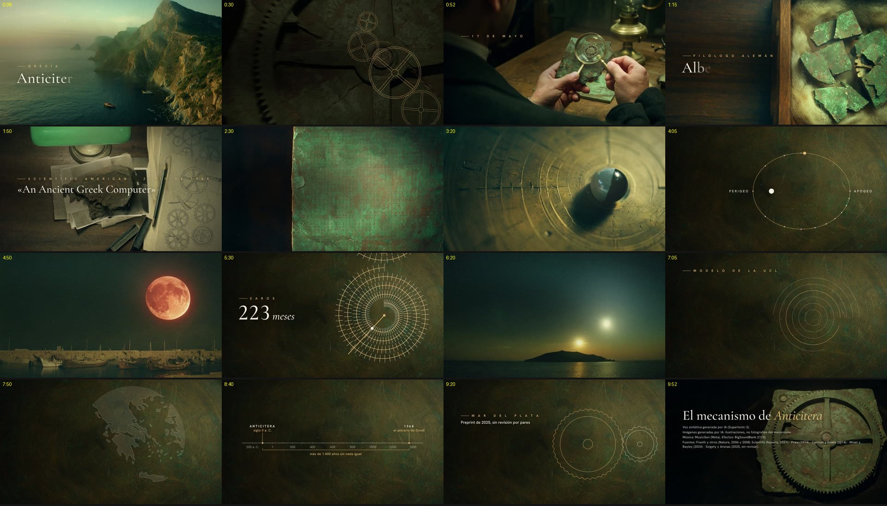

# Vídeos automatizados

Crear **vídeos largos a partir de un prompt**, con **edición de nivel agencia**, en local: sin GPU,
sin servicios de pago y sin que el texto salga de la máquina. Todo funciona en la CPU de una sesión en
la nube de Claude Code. Las imágenes generadas son material de apoyo; el vídeo lo hace la edición.

## Estado (31 de octubre de 2026)

**El canal en marcha es BusinessForMen** (negocios, en español; marca «Consejo»: grafito, blanco y carmesí). Su **primer vídeo, «Por qué quiebran empresas que ganan dinero», está terminado: 6 min 19 s**, 43 escenas de edición hechas a mano en HyperFrames y ancladas palabra a palabra a la voz (`canales/businessformen/kit/` y `canales/businessformen/videos/01-flujo-de-caja/`), con su miniatura, su descripción con fuentes y sus subtítulos (`PUBLICACION.md`). Las reglas de edición del canal están en `canales/businessformen/EDICION.md`.

**Y nueve cortos verticales para Reels, TikTok y Facebook** (`canales/businessformen/cortos/`), de 43–54 s, con una
historia real cada uno: «La cláusula», «La cuerda» y «Para siempre»; «El ancla», «El perrito» y «La pizza»; y «El
sueldo» (Ford), «La fórmula» (Coca-Cola) y «La cámara» (Kodak). El mismo archivo vale para las tres apps: sin logos de
ninguna ni «sígueme», con el gancho en el fotograma 0, subtítulos quemados, la imagen a pantalla completa y final en
bucle.

**Dos canales nuevos en prueba, elegidos con el rastreador:** geografía con mapas animados y historias reales de
supervivencia, cada uno con su marca y su voz, para Shorts y Reels. Su primer corto de cada uno está hecho:
«¿Por qué Chile es tan largo?» (60 s, `canales/geografia/cortos/01-chile/`) y, en supervivencia, tres: «La chica que
cayó del cielo» (69 s), «60 horas bajo el mar» (69 s) y «438 días a la deriva» (67 s), en `canales/supervivencia/cortos/`,
con la estrategia de retención de [canales/RETENCION.md](canales/RETENCION.md) y el sonido medido antes de renderizar.

**Antes, «El mecanismo de Anticitera», unos 10 minutos** (apertura y ocho capítulos; en pausa), en el estilo A,
con la voz M1, para el canal de historia y misterios. Se hace con un kit que arma cada capítulo en HyperFrames desde una
descripción corta anclada a las palabras de la narración (`videos/anticitera/kit/`), con dibujos animados para cada
idea difícil (engranajes, órbita, espirales, mapa, línea de tiempo). Todo se rehace con `preparar-apertura.sh`,
`preparar.sh` y `unir.sh`; el detalle, en la [bitácora](docs/bitacora.md#sesión-3--30-de-octubre-de-2026) y en
[videos/anticitera/](videos/anticitera/SPEC.md).



| Pieza | Herramienta | Estado |
| --- | --- | --- |
| Voz | Supertonic-3 M1 (principal) y Piper `es_AR-daniela-high` | ✅ `voz/narrar.py` |
| Imágenes | FastSD CPU + OpenVINO, modelos FLUX.3 Image Klein y SDXS | ✅ `imagen/generar.py` |
| Ampliación ×2 | EDSR de FastSD (ONNX) | ✅ `imagen/ampliar.py` |
| Tiempo de cada palabra | Alineación forzada en español (wav2vec2), o la de fonemas de Piper | ✅ `voz/alinear.py` |
| Música de fondo | MusicGen estéreo (uso no comercial); antes, síntesis con numpy | ✅ `audio/musica_ia.py` |
| Efectos de sonido | Grabaciones CC0 de BigSoundBank y la biblioteca de HyperFrames | ✅ `audio/efectos.py`, `audio/tecleo.py` |
| Mezcla de audio | Agache de la música bajo la voz, −14 LUFS | ✅ `audio/mezclar.py` |
| Animaciones en canvas | Canvas en Chromium → MP4 con desenfoque de movimiento | ✅ `video/renderizar_canvas.mjs` |
| Motor de edición y motion | HyperFrames 0.8.216 + GSAP; WebGL con llvmpipe de Mesa | ✅ instalado y medido, `video/hf.sh` |
| 2.5D y recortes | Depth Anything V2 Small, capas con OpenCV, BiRefNet lite | ✅ `imagen/profundidad.py`, `capas25d.py`, `recortar.py` |
| Volumen de entrega | loudnorm en dos pasadas a −15 LUFS | ✅ `video/entregar.sh` |
| Montaje de un vídeo largo | Kit del estilo A: capítulos desde una descripción anclada a la voz | ✅ `videos/anticitera/kit/montar.py` |
| Lecho de música | Una pieza de MusicGen extendida a la duración de un tramo | ✅ `audio/lecho.py` |
| Estilo de animación | A, editorial cinematográfico, elegido tras probar tres ([estilos/](estilos/README.md)) | ✅ elegido |
| Guion a partir del prompt | Lo escribe Claude en la sesión, con los datos comprobados en la web | ✅ probado en Anticitera |
| Montaje de agencia (BusinessForMen) | Una subcomposición por escena, con la marca y anclada a las palabras | ✅ `canales/businessformen/kit/montar.py` |
| Subtítulos | SRT desde los tiempos de la voz, con nombres y cifras bien escritos | ✅ `canales/businessformen/kit/subtitulos.py` |
| Cortos verticales | El mismo kit en 1080 × 1920: subtítulos quemados, zona segura de las apps y bucle | ✅ `canales/businessformen/cortos/` |
| Rastreador de nichos | Dataset de 5.600 M de vídeos de TikTok (DuckDB), API de YouTube con RSS, desmontaje de vídeos | ✅ `rastreador/` ([primer informe](rastreador/informes/2026-10-30.md)) |
| Varios canales | La marca de cada canal en `marca/canal.json` (voz, fuentes, colores); recursos de un corto con un comando | ✅ `montar.py --canal`, `canales/preparar-corto.sh` |
| Mapas animados | Fronteras de Natural Earth, proyección local a escala real y medidas propias | ✅ `canales/geografia/kit/geo.py` |
| Mezcla revisada | Cada efecto frente a la voz (EBU R128) sin renderizar, con el volumen que cabe | ✅ `audio/revisar_mezcla.py` |

## Empezar en una sesión nueva

Cada sesión arranca en una máquina limpia, así que lo primero es instalar las herramientas. El
instalador las deja fuera del repositorio, en `~/herramientas-videos`, porque pesan unos 14 GB:

```bash
./instalar.sh              # voz + imagen + edición (HyperFrames y modelos de apoyo)
./instalar.sh comprobar    # qué hay y qué falta
./instalar.sh precargar    # sesión reanudada: lee las herramientas en segundo plano (unos 6 min)
```

En una sesión nueva tarda unos 5–10 minutos (estimado por las velocidades de descarga medidas:
la mayor parte son los modelos de Hugging Face). Si ya está instalado, solo comprueba (7 s). Para que
se haga solo al abrir cada sesión, ver [docs/entorno.md](docs/entorno.md).

Necesita que la red del entorno permita `huggingface.co` y su CDN (`*.hf.co`).

## Cómo se usa cada pieza

```bash
# Imagen (la primera llamada arranca un servidor que deja el modelo cargado)
python3 imagen/generar.py "a lighthouse on a rocky coast at sunset, semi-realistic digital illustration" \
  -o faro.png --ancho 768 --alto 432
python3 imagen/generar.py "..." -o boceto.png --modelo sdxs     # medio segundo
python3 imagen/generar.py --lote escenas.json                   # varias de una vez

# Voz (con el Python del entorno de Piper): Supertonic-3 M1 por defecto
~/herramientas-videos/piper/bin/python voz/narrar.py --guion guion.json -o narracion.wav
~/herramientas-videos/piper/bin/python voz/narrar.py --guion guion.json -o narracion.wav --voz es_AR-daniela-high

# Música y mezcla
python3 audio/musica.py --duracion 60 -o musica.wav
python3 audio/mezclar.py --voz narracion.wav --musica musica.wav -o mezcla.wav

# Título animado (o cualquier escena HTML con window.cuadro(t))
node video/renderizar_canvas.mjs video/plantilla_titulo.html titulo.mp4 --duracion 5 \
  --param titulo="El faro" --param subtitulo="Capítulo 1" --audio mezcla.wav

# Edición con HyperFrames (desde la carpeta de un proyecto, ver estilos/)
../../video/hf.sh check --json
../../video/hf.sh render -o video.mp4 --quality high --crf 20   # ya con la calidad de entrega
video/entregar.sh video.mp4 entrega.mp4 -15 copiar   # −15 LUFS; el vídeo se copia sin recomprimir

# Apoyo a la edición (con el Python del entorno de FastSD)
PY=~/herramientas-videos/fastsdcpu/env/bin/python
$PY imagen/profundidad.py faro.png -o faro_prof.png         # mapa de profundidad, 3 s
$PY imagen/capas25d.py faro.png faro_prof.png -o faro        # sujeto y fondo para el 2.5D
$PY imagen/recortar.py brujula.png -o brujula_recorte.png --ajustar
$PY audio/musica_ia.py "slow cinematic ambient, soft piano, 70 bpm" -o musica.wav --duracion 12
python3 audio/efectos.py buscar "match" "typewriter"          # efectos CC0
python3 audio/efectos.py bajar 0004 -d sfx/
```

Los prompts de imagen funcionan mejor en inglés y descriptivos: sujeto, lugar, luz y estilo.

## Rendimiento medido aquí

La máquina cambia entre sesiones: siempre 4 núcleos, 15 GB de RAM y sin GPU, pero en las sesiones 1 y 3 fue un
Xeon con AMX y en la 2 un Cascade Lake a 2,8 GHz sin AMX.

| Tarea | Sesión 1 (con AMX) | Sesión 2 (sin AMX) | Sesión 3 (con AMX) | RAM |
| --- | --- | --- | --- | --- |
| Imagen FLUX.3 Image Klein, 512 × 512 | 37–39 s (73 s la primera) | 85 s (18,5 s por paso; 104 s la primera) | — | 8,2 GB |
| Imagen FLUX.3 Image Klein, 768 × 432 (16:9) | 53 s (95 s la primera) | — | — | 8,2 GB |
| Imagen FLUX.3 Image Klein, 1280 × 720 | 138–211 s | 328 s (246 s con 3 pasos) | 82–98 s (102–112 s en lote con otra tarea) | 8,2–12 GB |
| Imagen FLUX.2 klein 4B, 512 × 512 | 39–43 s | — | — | 9,3 GB |
| Imagen SDXS, 512 × 512 | 0,5 s (8–17 s la primera) | — | — | 5,0 GB |
| Voz Piper: 10 s de narración | 14,5 s, incluida la carga | — | — | — |
| Voz Supertonic-3 con tiempos de palabras | 7 s en 14 s | 58 s en 61 s (síntesis 41 s) | 8 min 26 s en 8 min 33 s (con FLUX a la vez) | 2 GB |
| Música sintetizada: 14 s | 1,9 s | — | — | — |
| Música MusicGen estéreo | 12 s en 50–55 s | 12 s en 69–96 s; en lote de 4, 31 s por cada 10 s | 4 piezas de 30 s en 410 s | 3 GB |
| Título animado: 4 s a 720p30 | 14 s | — | — | — |
| Profundidad (Depth Anything V2 Small) | 3 s por imagen | 5 s | — | — |
| Recorte (BiRefNet lite), 768 × 768 | 27 s | — | — | — |
| Render HyperFrames: 10 s a 1080p30 | 2 min–3 min 14 s, según el estilo | estilo A: 66 s (195 s al empezar); B: 114 s | estilo A con dibujos: 27–30 s | — |
| Ampliar ×2 con EDSR | — | 7 s desde 960 × 544; 12,5 s desde 1280 × 720 | 6 s desde 1280 × 720 | — |
| Entrega de 10 s de vídeo | — | 2,2 s copiando; 47 s recomprimiendo con preset slow | — | — |

«La primera» incluye cargar el modelo en memoria. La comparativa completa, con imágenes, está en
[docs/investigacion-imagenes.md](docs/investigacion-imagenes.md).


## Estructura

```
instalar.sh                 instala y comprueba las herramientas (fuera del repo)
imagen/generar.py           prompt → PNG; arranca y reutiliza imagen/servidor.py
imagen/servidor.py          servidor local que mantiene FastSD cargado y guarda PNG sin pérdida
imagen/profundidad.py       mapa de profundidad (Depth Anything V2 Small)
imagen/capas25d.py          sujeto y fondo rellenado para el 2.5D por capas
imagen/recortar.py          quita el fondo de un objeto (BiRefNet lite)
imagen/ampliar.py           amplía ×2 con EDSR (el de FastSD) y encaja en 1920 × 1080
imagen/pruebas/             banco de pruebas: comparar modelos y montar hojas comparativas
voz/narrar.py               texto o guion → WAV + JSON con los tiempos de cada frase y palabra
voz/alinear.py              tiempo de cada palabra de cualquier voz (alineación forzada)
voz/supertonic_frases.py    síntesis con Supertonic-3 (la usa narrar.py)
audio/musica_ia.py          música de fondo con MusicGen
audio/efectos.py            busca y baja efectos de sonido CC0 (BigSoundBank)
audio/tecleo.py             pista de máquina de escribir con teclas reales
audio/musica.py             música de fondo sintetizada (la primera versión)
audio/mezclar.py            voz + música con agache y volumen estándar
audio/revisar_mezcla.py     cuánto suena cada efecto de un proyecto frente a la voz (antes de renderizar)
video/hf.sh                 HyperFrames con la configuración del entorno (WebGL con llvmpipe, 2 Chromium)
video/chrome-llvmpipe.sh    Chrome para HyperFrames: WebGL en llvmpipe y la página en la CPU
video/entregar.sh           versión de entrega: −15 LUFS y archivo más ligero
video/renderizar_canvas.mjs escena HTML animada → MP4
video/plantilla_titulo.html plantilla de título animado
estilos/                    las tres pruebas de estilo en HyperFrames y su preparar.sh
videos/anticitera/          el primer vídeo: guion, prompts, preparar-apertura.sh y la apertura en HyperFrames
canales/businessformen/     el primer canal: marca, kit de montaje (montar.py, también para los demás canales), vídeos y cortos
canales/geografia/          canal de prueba de geografía: marca, kit de mapas (geo.py) y cortos
canales/supervivencia/      canal de prueba de historias reales de supervivencia: marca, reglas de sonido y cortos
                            (con sus plantillas comunes en cortos/comun/)
canales/RETENCION.md        cómo se escribe y se monta un corto para que se vea entero
canales/preparar-corto.sh   fuentes, texturas, voz, música e imágenes de un corto de cualquier canal
rastreador/                 nichos y vídeos que funcionan: tiktok.py (dataset), youtube.py (Shorts), desmontar.py; informes/
docs/                       bitácora, investigaciones (imagen, edición y rastreador de nichos), estilo, entorno y resultados
CLAUDE.md                   contexto e instrucciones para Claude en cada sesión
```

## Siguiente paso

Que el usuario vea los cortos 7–9 de BusinessForMen (`salidas/businessformen/cortos/*/entrega/`) y los de los canales
nuevos (`salidas/geografia/cortos/*/entrega/` y `salidas/supervivencia/cortos/*/entrega/`), elija los nombres de los
canales y los publique; medir a las 48 h y
a los 7 días y, mientras, producir la semana con el mismo kit. El plan está en
[docs/bitacora.md](docs/bitacora.md#siguiente-paso).


## Licencias

El código del repositorio es del proyecto. Las herramientas y modelos se descargan aparte, cada
uno con su licencia:

- FastSD CPU y stable-diffusion.cpp: MIT. Piper: GPL-3.0 (se usa como programa externo).
- FLUX.3 Image Klein: FLUX Kommunity License, gratis para personas y empresas de menos de 5 M$ al año.
- FLUX.2 klein 4B: Apache 2.0. SDXS: OpenRAIL++.
- HyperFrames: Apache 2.0. GSAP: licencia gratuita de GreenSock. Fuentes de las pruebas: OFL
  (Special Elite: Apache 2.0).
- Depth Anything V2 Small: Apache 2.0. BiRefNet lite: MIT. MusicGen: CC BY-NC 4.0, **solo uso no
  comercial**; para uso comercial habría que cambiar de modelo de música.
- Efectos: BigSoundBank, CC0; biblioteca de HyperFrames, licencia de Pixabay.
- Supertonic-3: Open RAIL-M. Permite uso comercial, pero obliga a avisar de que el contenido está
  generado por máquina y prohíbe suplantar a personas. Alineador wav2vec2 en español: Apache 2.0.
- Voces de Piper: `es_AR-daniela-high` se entrenó con datos CC BY-SA 4.0 (OpenSLR 61) y
  `es_MX-claude-high` con datos Apache 2.0. Conviene revisarlas antes de un uso comercial.
