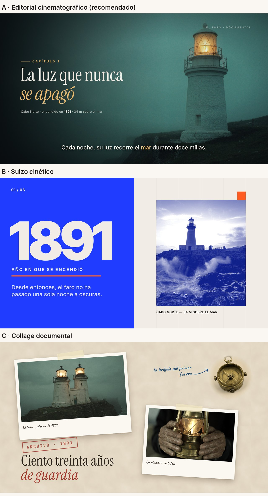

# Estilo de animación

Estado: **propuesta, pendiente de que el usuario elija.** Tres estilos completos, pensados para
ejecutarse con HyperFrames + GSAP y con imágenes de FLUX.3 como material. La recomendación es el A como
estilo de la casa, con los otros dos como «modos» que comparten su paleta y su tipografía.

Los tres siguen el oficio de `docs/investigacion-edicion.md`: curvas según el papel, títulos quietos
al aterrizar, transiciones con causa, lectura de 0,5 s + 0,3 s por palabra y sonido en cada acción visible.

## A. Editorial cinematográfico (recomendado)

Un documental de marca: la imagen es cine y la tipografía es de revista. Sirve para vídeos largos
porque aguanta minutos sin cansar y admite datos, archivo y emoción.

| Elemento | Especificación |
| --- | --- |
| Paleta | Suelo `#0D1114`, tinta `#F3EDE4`, acento ámbar `#E8B66A` (uno solo, y con significado); atmósfera al 15–25 % |
| Tipografía | Titulares: Instrument Serif 400, la palabra clave en cursiva y en acento. Texto y datos: Inter 500/600, cifras tabulares. Capítulos: Inter 600, versalitas con tracking de 0,32 em |
| Tamaños | Titular al 9–13 % de la altura del cuadro; texto secundario al 2,5–4 %; subtítulos al 3,7 % |
| Imagen | Planchas de FLUX.3 a sangre, con el mismo sufijo de dirección de arte en todos los prompts: *«cinematic, 35mm film look, muted teal and amber palette, soft natural light»*. Siempre graduadas igual, con grano al 14 % y viñeta |
| Cámara | Paralaje 2.5D con mapa de profundidad, o empuje con intención que termina antes del corte. Nada de zoom lento eterno sobre un título |
| Entradas | Titular palabra a palabra con desenfoque de 6 px a 0 (0,13 s cada una, 67 ms de separación); dato de gris a tinta; nombre propio letra a letra |
| Curvas | Llegadas `expo.out` 0,6–0,9 s; cámara `power2.inOut`; salidas `power3.in`, un 40–50 % más cortas |
| Transiciones | Cambio con desenfoque sobre la misma plancha; corte con oscurecido del 40 % durante 3 cuadros; barrido horizontal (0,13–0,3 s) al cambiar de lugar; destello de luz entre capítulos; un detalle de la imagen que crece hasta ser la siguiente escena |
| Gráficos | Filetes finos, números de capítulo, etiquetas de datos con línea guía, contadores de 1,2–1,6 s que aterrizan en el golpe, mapas sobre imagen real |
| Subtítulos | Frase a frase, centrados abajo, Inter 500 con sombra suave, una palabra en acento, máximo dos líneas, dentro del 80 % seguro |
| Sonido | Cama musical bajo la voz con agache; barrido en cada whip, golpe suave cuando aterriza un título, subida antes de cada capítulo |
| Ritmo | Planos de 3–6 s con movimiento dentro; un capítulo cada 60–90 s |

## B. Suizo cinético

La retícula manda: campos de color planos, cifras enormes y cortes al compás. Para datos, listas,
comparaciones y piezas cortas para redes.

| Elemento | Especificación |
| --- | --- |
| Paleta | Papel `#F1EDE6`, cobalto `#1F3CFF`, naranja señal `#FF5A1F`, tinta `#121212` |
| Tipografía | Inter Display Black para cifras y titulares gigantes; Inter Bold en versalitas para etiquetas |
| Retícula | 12 columnas visibles con filetes del 8 %; todo encaja en ella, también las imágenes |
| Imagen | Módulos dentro de la retícula en duotono (blanco y negro con cobalto en «trama») |
| Movimiento | Más seco: 0,3–0,5 s, muelles de 0,7–0,85 en posición, escalonado de 40–80 ms |
| Transiciones | Inundación de color de 0,4 s, cortes en el golpe (como mucho un tercio de las uniones), la retícula se reordena sin salir del cuadro |
| Gráficos | Barras y líneas que se dibujan, contadores, índices «01 / 06» |
| Sonido | Ritmo marcado; el diseño cambia en cada compás |

## C. Collage documental

Papel, fotos impresas, cinta adhesiva, sellos y notas a mano. Para historia, memoria y cultura.

| Elemento | Especificación |
| --- | --- |
| Paleta | Papel `#E9DFCC` con textura, tinta sepia `#2A221B`, rojo sello `#A3362B`, azul de bolígrafo `#1F4D7A` |
| Tipografía | Instrument Serif para titulares; Caveat para anotaciones; JetBrains Mono para etiquetas de archivo |
| Imagen | Planchas como fotos impresas con borde blanco y leve giro; recortes de objetos (BiRefNet) sobre el papel |
| Movimiento | Los elementos del collage se mueven «a doses» (12 fps) para dar tacto de stop motion, mientras la cámara se desliza suave a 30 fps |
| Transiciones | La cámara viaja por una mesa enorme de un grupo de fotos al siguiente; papel que entra empujando; flechas que se dibujan hacia el siguiente detalle |
| Sonido | Papel, cinta, lápiz y obturador de cámara en cada gesto |

## Cómo se combinan

En un vídeo largo, A es la base y B y C entran como modos: un tramo de datos usa la retícula de B con la
paleta y la tipografía de A; un tramo de archivo usa el collage de C con esa misma tipografía. Así hay
variedad sin perder la marca. Una película usa 3–5 tipos de transición, no todos.

## Lo que nunca hacemos

- Títulos que flotan, respiran o siguen escalando después de aterrizar.
- La misma curva y la misma duración en todo.
- Fundidos entre mundos distintos, viñetas de diapositiva y tres tarjetas en fila.
- Todo lo de una escena en pantalla en el primer cuarto y luego quieto.
- Una narración que repite palabra por palabra el texto en pantalla.
