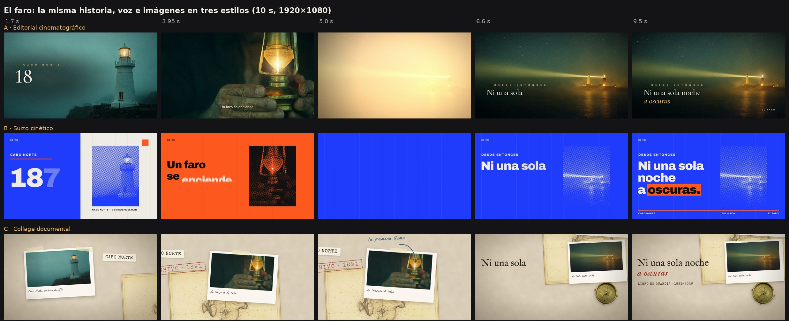

# Estilo de animación

Estado: **probados en tres vídeos de 10 s ([estilos/](../estilos/README.md)), pendiente de que el
usuario elija.** Tres estilos completos, hechos con HyperFrames + GSAP y con imágenes de FLUX.3 como
material. La recomendación sigue siendo el A como estilo de la casa, con los otros dos como «modos» que
comparten su paleta y su tipografía.

Las tablas recogen la versión probada. Respecto a la primera propuesta cambiaron las tipografías: la guía
de HyperFrames avisa de que Instrument Serif, Inter y JetBrains Mono son donde acaba el diseño hecho por
defecto, y el collage pedía letras de época.

Los tres siguen el oficio de `docs/investigacion-edicion.md`: curvas según el papel, títulos quietos
al aterrizar, transiciones con causa, lectura de 0,5 s + 0,3 s por palabra y sonido en cada acción visible.

## A. Editorial cinematográfico (recomendado)

Un documental de marca: la imagen es cine y la tipografía es de revista. Sirve para vídeos largos
porque aguanta minutos sin cansar y admite datos, archivo y emoción.

| Elemento | Especificación |
| --- | --- |
| Paleta | Suelo `#0D1114`, tinta `#F3EDE4`, acento ámbar `#E8B66A` (uno solo, y con significado); atmósfera al 15–25 % |
| Tipografía | Titulares: Cormorant Garamond 500, la palabra clave en cursiva y en acento. Etiquetas y subtítulos: Hanken Grotesk 500/600, capítulos en versalitas con tracking de 0,32 em, 28 px como mínimo |
| Tamaños | Titular al 9–13 % de la altura del cuadro; texto secundario al 2,5–4 %; subtítulos al 3,7 % |
| Imagen | Planchas de FLUX.3 a sangre (1280 × 720, escaladas a 1080p), con el mismo sufijo en todos los prompts: *«cinematic, muted teal and amber palette, 35mm film look»*. Etalonaje, viñeta y grano en el shader de `planchas.html`, iguales en todas |
| Cámara | Paralaje 2.5D por capas (`imagen/capas25d.py`: sujeto y fondo rellenado), con empuje que termina antes del corte. Nada de zoom lento eterno sobre un título |
| Entradas | Titular palabra a palabra con desenfoque de 6 px a 0 (0,13 s cada una, 67 ms de separación); dato de gris a tinta; nombre propio letra a letra |
| Curvas | Llegadas `expo.out` 0,6–0,9 s; cámara `power2.inOut`; salidas `power3.in`, un 40–50 % más cortas |
| Transiciones | Cambio con desenfoque sobre la misma plancha; corte con oscurecido del 40 % durante 3 cuadros; barrido horizontal (0,13–0,3 s) al cambiar de lugar; destello de luz entre capítulos; un detalle de la imagen que crece hasta ser la siguiente escena |
| Gráficos | Filetes finos, números de capítulo, etiquetas de datos con línea guía, contadores de 1,2–1,6 s que aterrizan en el golpe, mapas sobre imagen real |
| Subtítulos | Frase a frase, centrados abajo, Inter 500 con sombra suave, una palabra en acento, máximo dos líneas, dentro del 80 % seguro |
| Sonido | Música de cine (MusicGen: cuerdas graves y piano, 70 BPM) con agache bajo la voz; ambiente real (olas, sirena de niebla), barrido en cada whip, el gesto de la imagen (una cerilla cuando se enciende la lámpara), golpe suave cuando aterriza el título |
| Ritmo | Planos de 3–6 s con movimiento dentro; un capítulo cada 60–90 s |

## B. Suizo cinético

La retícula manda: campos de color planos, cifras enormes y cortes al compás. Para datos, listas,
comparaciones y piezas cortas para redes.

| Elemento | Especificación |
| --- | --- |
| Paleta | Papel `#F1EDE6`, cobalto `#1F3CFF`, naranja señal `#FF5A1F`, tinta `#121212` |
| Tipografía | Archivo variable (peso 100–900, ancho 62–125): 900 para cifras y titulares; las palabras aparecen ensanchándose de 62 a 100. Etiquetas en 700–800 en versalitas |
| Retícula | 12 columnas visibles con filetes del 8 %; todo encaja en ella, también las imágenes |
| Imagen | Módulos dentro de la retícula con trama de puntos de dos tintas (`monoScreen` de HyperFrames con la paleta: cobalto sobre papel, tinta sobre naranja) |
| Movimiento | Más seco: 0,3–0,5 s, muelles de 0,7–0,85 en posición, escalonado de 40–80 ms |
| Transiciones | Inundación de color de 0,4 s, cortes en el golpe (como mucho un tercio de las uniones), la retícula se reordena sin salir del cuadro |
| Gráficos | Barras y líneas que se dibujan, contadores, índices «01 / 06» |
| Sonido | Electrónica mínima a 120 BPM (MusicGen) recortada para que el pulso caiga en 0,5 s exactos; teclas en cada cifra, barridos en las inundaciones, «pop» en los elementos que aterrizan |
| Acento | El naranja sobre cobalto se lee mal (2,1:1): la palabra clave va en tinta sobre un bloque naranja que se pinta como un rotulador |

## C. Collage documental

Papel, fotos impresas, cinta adhesiva, sellos y notas a mano. Para historia, memoria y cultura.

| Elemento | Especificación |
| --- | --- |
| Paleta | Papel `#E9DFCC` con textura, tinta sepia `#2A221B`, rojo sello `#A3362B`, azul de bolígrafo `#1F4D7A` |
| Tipografía | IM Fell English (de imprenta antigua) para titulares; La Belle Aurore (pluma) para anotaciones; Special Elite (máquina de escribir) para etiquetas y sellos |
| Imagen | Planchas como fotos impresas con borde blanco, pie a pluma y leve giro, tratadas con `vintage-wash` y grano; recortes de objetos (BiRefNet) y una carta náutica de FLUX sobre la mesa |
| Movimiento | Los elementos del collage se mueven «a doses» (12 fps) para dar tacto de stop motion, mientras la cámara se desliza suave a 30 fps |
| Transiciones | La cámara viaja por una mesa enorme de un grupo de fotos al siguiente; papel que entra empujando; flechas que se dibujan hacia el siguiente detalle |
| Sonido | Guitarra y piano de documental (MusicGen, 90 BPM); foley real en cada gesto: papel, cinta adhesiva, máquina de escribir (una tecla por letra), sello, pluma y campanilla |

## Lo que mostraron las pruebas

- **A** es el más «de cine» y el que mejor aguanta minutos, pero depende de la calidad de cada plancha:
  la imagen ocupa todo el cuadro y un defecto de FLUX se ve (hubo que borrar una mancha junto a la mano).
- **B** es el más robusto ante imágenes flojas (la trama las convierte en textura) y el más «de marca»;
  para un vídeo largo puede cansar si no se alterna con otro modo.
- **C** es el más artesanal y el que más recursos pide por minuto (fotos, notas, recortes, foley).
- Render en esta CPU: A 12 s por segundo de vídeo, B 15 s, C 19 s. Un vídeo de 10 min serían unas 2, 2,5
  y 3 horas. Para vídeos largos conviene renderizar por capítulos.

## Cómo se combinan

En un vídeo largo, A es la base y B y C entran como modos: un tramo de datos usa la retícula de B con la
paleta y la tipografía de A; un tramo de archivo usa el collage de C con esa misma tipografía. Así hay
variedad sin perder la marca. Una película usa 3–5 tipos de transición, no todos.

## Lo que nunca hacemos

- Títulos que flotan, respiran o siguen escalando después de aterrizar.
- La misma curva y la misma duración en todo.
- Fundidos entre mundos distintos, viñetas de diapositiva y tres tarjetas en fila.
- Todo lo de una escena en pantalla en el primer cuarto y luego quieto.
- Una narración que repite palabra por palabra el texto en pantalla.
